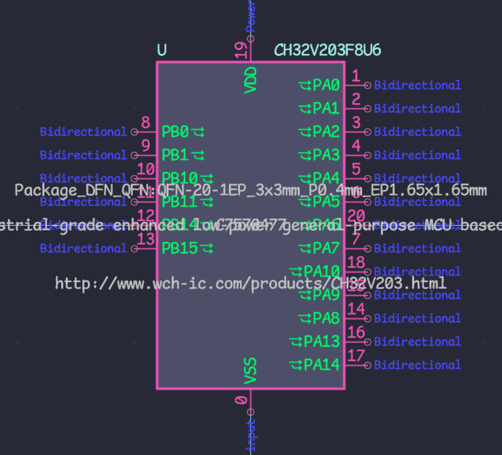
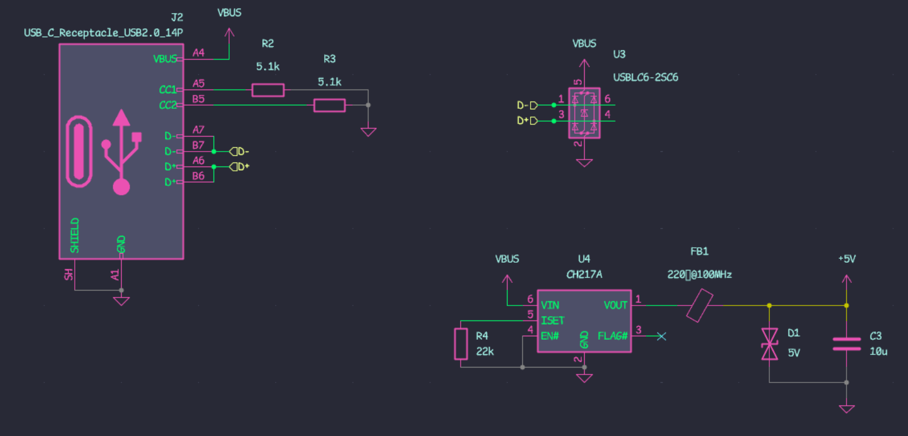
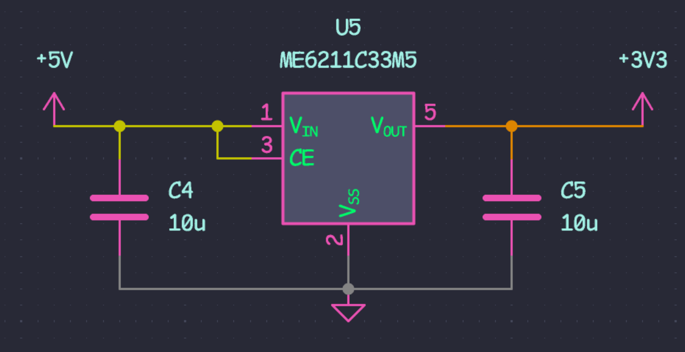
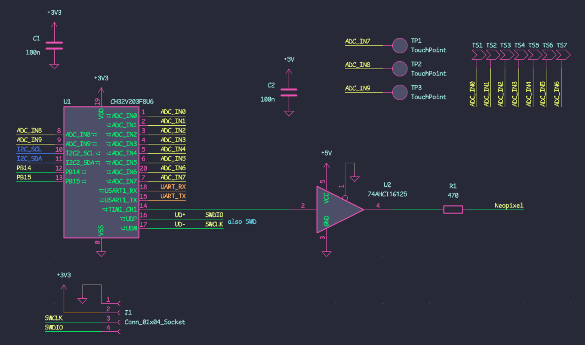
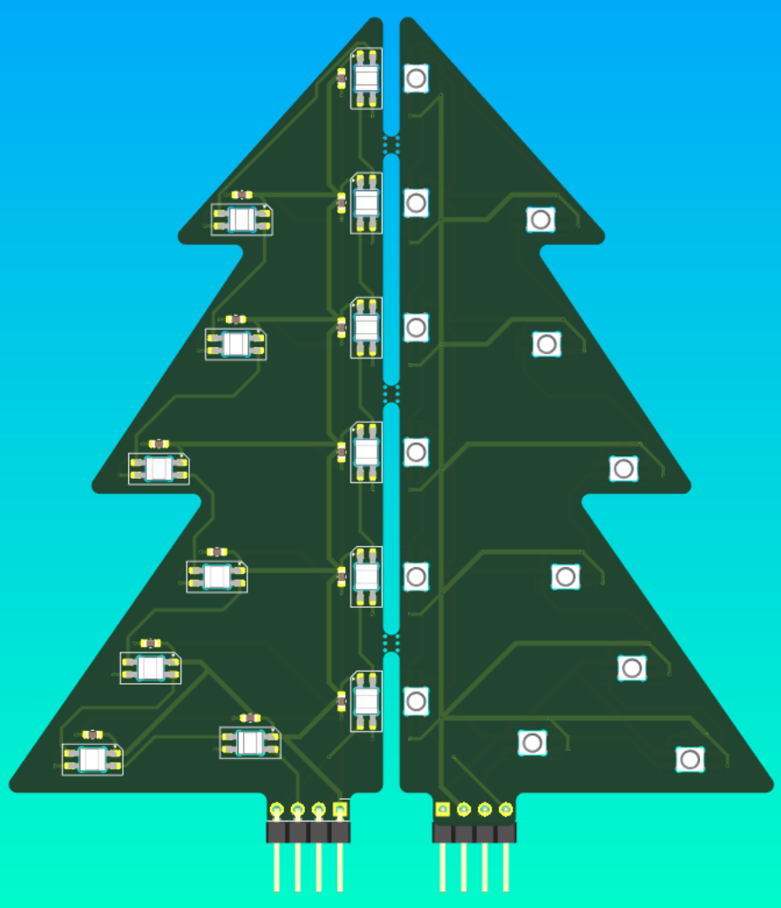
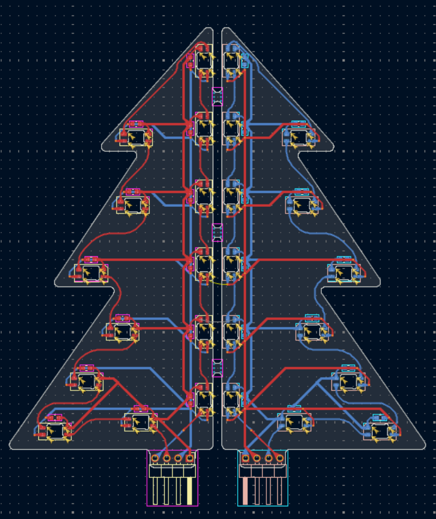

# Nov 11: Researched main parts for project

## High level part list:

- [CH32V203F8U6](https://www.lcsc.com/product-detail/C7570477.html) - Main MCU for project. Has lots of ADC/TouchKeys, GPIO, UART, SWD, USB (very good)
- [SK6812MINI-E](https://www.lcsc.com/product-detail/C5149201.html) - Small, easy to solder, and bright
- [ME6211C33M5](https://www.lcsc.com/product-detail/C82942.html) - Low-noise, high current, simple 3.3V LDO for MCU
- [74AHCT1G125GW](https://www.lcsc.com/product-detail/C52953352.html) - Cheap knockoff logic level shifter for MCU -> Neopixel comms

## Software plan:

CH32 MCU will be programmed via USB or SWD, and will have predertimined lights patterns, as well as inputs from touch keys.

**Total time spent: 2h**

# Nov 12: Made a symbol for the MCU

After forever, I have finished making the symbol for the MCU that I am planning to use. I also learned about KiCad pin functions for the same pin, it is really useful when the GPIO can multiplex to different functions like ADC, SPI, I2C, on the same pin.

**Total time spent: 2h**

# Nov 13: Finished USB C routing

Finished USB C schematic. Has data lines for MCU, as well as ESD on both data and power. Noise filtering with ferrite bead and OCP, UVP protection with [CH217](https://www.lcsc.com/product-detail/C54973763.html).

**Total time spent: 1h**

# Nov 22: Finished rest of schematic

Sorry for the lack of segments but I made custom symbols for the touch keys, touch sliders, and wired everything together.

I also added net classes and assign them colours. My schematic is so colourful now lol.

**Total time spent: 7h**

# Nov 23: Made the leaf PCBs! All done now!

**Total time spent: 3h**

